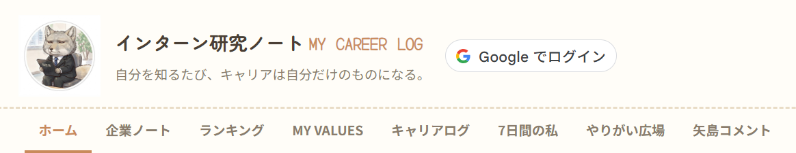

# 📔 MY CAREER LOG

**企業を見ることを、自分を知ることにつなげる就活ノートアプリです。**

所属している就活ゼミの1週間インターンで、**ゼミのメンバーみんなが使えるように**、2人で開発しました。デザインはもう1人のメンバーが担当し、私はデザイン以外の機能を生成AIを活用しながら実装しました。
企業のことは調べても、「その企業を見て自分が何を感じたか」は記録に残りにくいものです。
このアプリでは、企業や経験ごとに気持ちや価値観を書きため、経験のたびに自分の価値観・強み・次の挑戦を更新していけるようにしました。

🔗 **デモ**：https://amane0905.github.io/my-portfolio/My_Careel_Log/



---

## 開発の概要

| 項目 | 内容 |
|---|---|
| 開発の場 | 就活ゼミの1週間インターン |
| 開発期間 | 1週間 |
| チーム | 2人（デザイン担当1名・機能実装担当1名） |
| 自分の担当 | 機能実装のほぼすべて（ログイン・クラウド保存・各画面の機能・アドバイザー用の権限分け）と、利用者向け使い方ガイドの作成 |
| 開発の進め方 | 生成AIを活用して実装 |
| 利用者 | ゼミのメンバーと、ゼミのアドバイザー <!-- 人数が分かれば「◯人」と書くと具体的になります --> |

---

## 画面と機能

| 画面 | できること |
|---|---|
| **ホーム** | 企業ノート・キャリアログ・価値観タグの件数と最終更新日時を確認できます。記録の書き出し・読み込み・全削除もここから行います。 |
| **企業ノート** | 企業ごとに、接点の種類（インターン・説明会・面接など）、学んだこと、感想、質問した内容とその理由、魅力や違和感を記録します。5つの軸（仕事内容・成長・人と社風・働き方・自分らしさ）で星評価をつけ、価値観タグを残せます。 |
| **ランキング** | 星評価の高い順に企業が並び、今の自分が何に惹かれているかが分かります。 |
| **MY VALUES** | 企業ノートとキャリアログで付けた価値観タグを自動で集計し、よく出てくるタグほど大きく表示します。タグを押すと、どの記録から見つかったかを確認できます。 |
| **キャリアログ** | アルバイト・授業・サークル・旅行など、どんな経験でも「何があったか → どう感じたか → なぜそう感じたか → 自分のどんな部分が出たか → 次に何をするか」の順で記録できます。 |
| **7日間の私** | 直近7日間の気づきを記録し、「いまの私」欄（VALUE / STRENGTH / WEAKNESS / CHALLENGE）にタグとして整理します。まとめは画像やPDFとして保存できます。 |
| **やりがい広場** | 「一番やりがいを感じる瞬間」を短い言葉でゼミのみんなとリアルタイムに共有します（友人が作成したツールを埋め込んで連携）。 |
| **先生コメント** | ゼミのアドバイザーと Day1〜Day7 のやり取りをする画面です。学生は「今日のひとこと」を書き、アドバイザーは全員分を読んでコメントを返せます。 |

詳しい使い方は、利用者向けに作成した使い方ガイドにまとめています。<!-- PDFを docs/ に置く場合は、ここにリンクを貼ります -->

---

## 使い方

1. **アプリを開く**：ログインしなくてもすぐに記録を始められます。
2. **Google でログイン（推奨）**：ログインすると記録がクラウドに保存され、PCとスマホなど別の端末からも同じ記録を見られます。
3. **企業ノートを書く**：インターンや説明会に参加したら「＋ 企業を追加」から記録し、星評価と価値観タグを付けます。
4. **経験を記録する**：就活以外の経験も、キャリアログに書きためます。
5. **振り返る**：「ランキング」「MY VALUES」「7日間の私」で、自分が大事にしていることを確認します。
6. **アドバイザーとやり取りする**：「先生コメント」で毎日ひとこと書き、コメントをもらいます。

> ⚠ スマホで LINE や Instagram のアプリ内ブラウザから開くと、Google の仕様でログインできません。Safari や Chrome で開き直してください。

---

## 使用技術

| 分類 | 技術 |
|---|---|
| フロントエンド | HTML / CSS / JavaScript |
| 認証 | Firebase Authentication（Google ログイン） |
| データ保存 | Cloud Firestore（ログイン時）/ ブラウザの localStorage（未ログイン時） |
| 公開 | GitHub Pages |

---

## 工夫した点

- **ログインしなくても使える設計**：最初の一歩のハードルを下げるため、未ログインでもブラウザ内に記録できるようにしました。ログインすればクラウドに保存され、複数の端末で使えます。
- **アカウントごとの見え方を分ける**：学生どうしでは他の人のやり取りが見えず、アドバイザーのアカウントだけが全員分を見てコメントできるように権限を分けました。
- **他の人の記録が残らない配慮**：ログアウトすると端末の画面表示をリセットし、同じ端末で別の人がログインしても前の人の記録が見えないようにしました。
- **書きやすさの工夫**：キャリアログは質問に答える順番で書けるようにし、自己分析に慣れていない人でも書き進められるようにしました。
- **データを手元に残せる**：記録を1つのファイルに書き出し、別の端末で読み込めるようにしました。読み込み時は上書きせず、今ある記録と合わせて残します。
- **利用者向けの使い方ガイドを作成**：ゼミのメンバーが迷わず使えるよう、全機能の説明とトラブル時の対処をまとめたガイドを用意しました。

<!-- 苦労した点・その解決方法を1〜2個追加すると、面接で話しやすくなります。
例：アプリ内ブラウザでGoogleログインが失敗する問題に気づき、原因を調べて案内を追加した -->

---

## 使ってもらった反応

<!-- ゼミのメンバーやアドバイザーからもらった感想、それを受けて直したところがあれば書きます。
「実際に人に使ってもらい、改善した」経験は、面接でとても評価されやすい部分です。 -->

---

## ローカルで動かす方法

ビルドは不要です。静的ファイルとして配信すれば動作します。

```bash
git clone https://github.com/amane0905/my-portfolio.git
cd my-portfolio/My_Careel_Log
npx serve .
```
